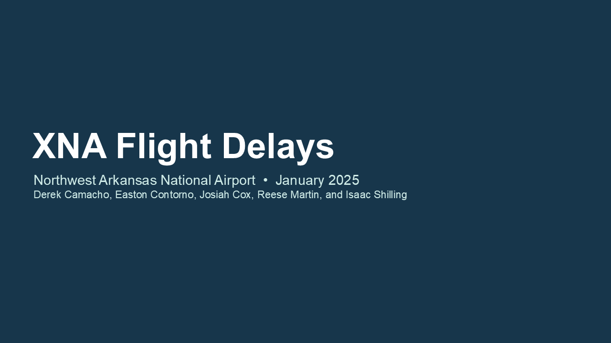

## Team

This project was completed as a team for INEG 21003 Data Visualization at the University of Arkansas. Every member contributed to the analysis and the slides.

- Derek Camacho
- Easton Contorno
- Josiah Cox
- Reese Martin
- [Isaac Shilling](https://isaacshilling06.github.io/)

## The Data Set

Our data set comes from the U.S. Department of Transportation's Bureau of Transportation Statistics (BTS) Reporting Carrier On-Time Performance data. We pulled every scheduled departure from Northwest Arkansas National Airport (XNA) in January 2025, which came to 933 flights. Each row is one flight, and the columns include the flight date, the operating carrier code (for example MQ, OH, AA, and OO), the departure delay in minutes, the arrival delay at the destination in minutes, whether the flight was canceled, the flight distance in miles, and the air time in minutes.

We pasted the data into an Excel workbook, gave the columns meaningful names, and cleaned it on a Flight Data sheet. Canceled flights do not have delay or air time values, so those blanks were left out of the calculations instead of being treated as zero. All of the summary tables and charts were built on a separate Plots sheet. Each of our four questions uses different columns of the data set.

## Question 1: How did departure delays at XNA change over the month of January 2025?

**Why it's interesting:** XNA is our home airport, and most of us fly out of it to get home for breaks. January brings winter weather to Northwest Arkansas, and we wanted to know whether delays built up steadily over the month or hit in sudden spikes on specific days.

**How we used Excel:** Using the flight date and departure delay columns, the Plots sheet groups the 898 recorded departure delays by date and calculates the average delay for each day of January. Negative values mean flights left early. The daily averages showed that January 10 stood out, with 14 flights averaging 185 minutes late.

**How we developed the visual:** Because the question is about change over clock time, we used a time-series line chart with the date on the horizontal axis and the daily average delay in minutes on the vertical axis. We kept one line color, labeled the axis with its units, and kept zero visible so early days read as below the line. The assertion headline states the main finding, the January 10 peak, and the supporting text adds that daily averages fluctuated rather than rising steadily.

## Question 2: Which operating carriers canceled the largest share of their XNA flights?

**Why it's interesting:** When we book a flight home, the airline we pick matters, and a cancellation is much more disruptive than a delay. We wanted to see if some carriers at XNA canceled more often than others, and whether the carrier with the most cancellations was really the least reliable.

**How we used Excel:** Using the operating carrier and canceled columns, the Plots sheet counts scheduled departures and cancellations for each carrier and divides cancellations by scheduled departures to get a cancellation rate. The scheduled flights were OH 20, AA 99, YX 92, MQ 473, OO 162, F9 4, G4 52, and UA 31, for all 933 departures. Comparing rates instead of counts mattered: MQ had the most cancellations (20) but a 4.2% rate, while OH canceled only 2 flights but had the highest rate at 10%.

**How we developed the visual:** Comparing one value across categories called for a bar chart. We sorted the carriers from the highest to the lowest cancellation rate, formatted the vertical axis as percentages, and labeled both axes. The headline makes the claim and the supporting text gives the counts behind the two most important bars. Since this is only one month of data, we were careful not to claim that the carrier caused the difference.

## Question 3: How are arrival delays for flights leaving XNA distributed?

**Why it's interesting:** An average can hide what a typical trip is like. We wanted to know whether most flights from XNA get to their destination on time, and how often a flight ends up extremely late, which matters for connections and rides at the other end.

**How we used Excel:** Using the arrival delay column, we sorted the recorded arrival delays into 60-minute bins and counted how many flights fell in each bin. Missing arrival delays were left out, and empty bins and the largest delay were kept so the full range shows. Of the 897 recorded arrivals, 575 (64%) were early, and the longest delay was 1,810 minutes.

**How we developed the visual:** Showing the distribution of one numerical variable called for a histogram. We removed the gaps between bars so the bins touch, labeled each bin by its midpoint (for example, -30 represents -60 to under 0 minutes), and labeled the vertical axis as the number of flights. The long right tail is the key takeaway, so the headline says most flights arrived early but a few ran hours late.

## Question 4: How is a flight's distance related to the time it spends in the air?

**Why it's interesting:** XNA has nonstop flights to cities both close by and far away. We expected longer flights to take longer, but we wanted to see how strong that relationship really is, and how much flights covering the same distance vary.

**How we used Excel:** Using the distance and air time columns, the Plots sheet pairs distance in miles with air time in minutes for each of the 897 flights that had both values. We calculated the Pearson correlation coefficient from those same pairs and got r = 0.94, a strong positive relationship. Air time does not include taxiing.

**How we developed the visual:** Two numerical variables called for a scatter plot, with distance on the horizontal axis and air time on the vertical axis, both labeled with units. Each marker is one flight, so flights on the same route stack into vertical groups, which shows how much air time varies at a fixed distance. The supporting text includes the correlation coefficient so the headline's claim is backed by a number.

