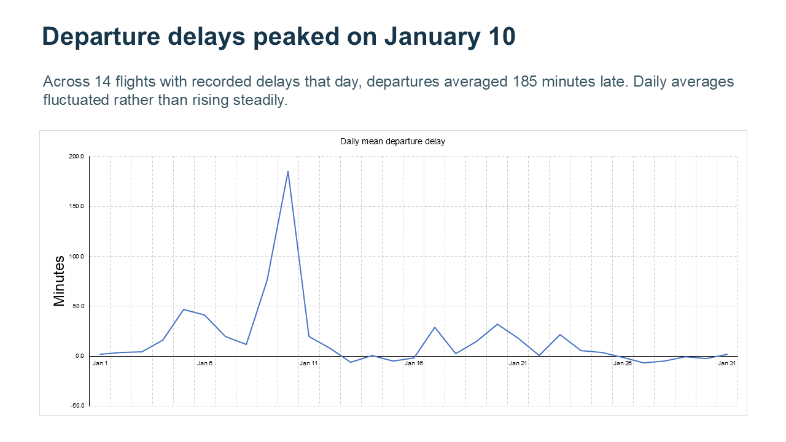
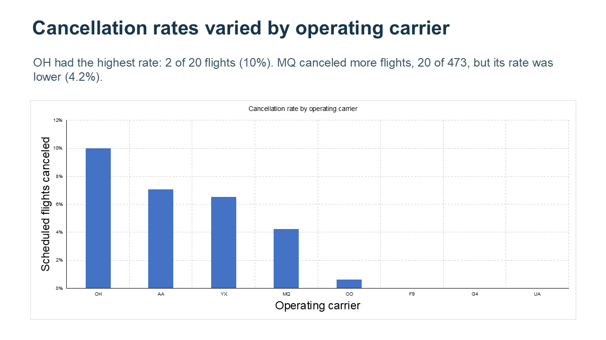
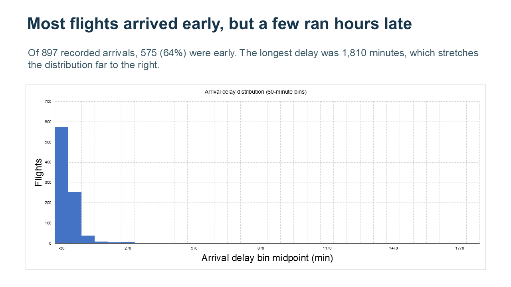
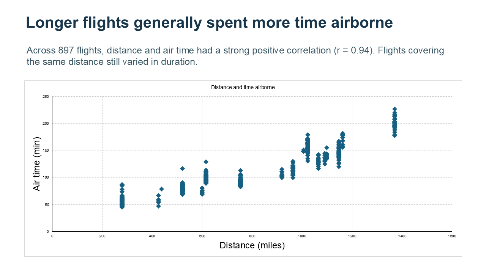

## Team

This project was completed as a team for INEG 21003 Data Visualization at the University of Arkansas. Every member contributed to the analysis and the slides.

- Derek Camacho
- Easton Contorno
- Josiah Cox
- Reese Martin
- [Isaac Shilling](https://isaacshilling06.github.io/)

## The Data Set

The data we used came from the U.S. Department of Transportation's Bureau of Transportation Statistics Reporting Carrier On-Time Performance data that we found online. We were able to pull every departure from January 2025 from XNA which was 933 flights total. Each row is one flight and we included columns that cover the flight date, the operating code, the departure delay, the arrival delay, whether the flight was canceled or not, the flight distance, and finally the actual air time.

We pasted the data we got into excel and gave the columns meaningful names via the stuff that was in the original data and cleaned it with AI to make the flight data sheet. Canceled flights do not have delay or air time values so we just left them out of calculations instead of just treating them as 0's. All of the summary tables and charts we built are on a separate plots sheet. each of the 4 questions we asked make up their own column.

## Question 1: How did departure delays at XNA change over the month of January 2025?

**Why it's interesting:** XNA is the closest big airport we have here in fay and those who fly out to get home over breaks most likely use XNA. Because January brings winter weather here we wanted to know whether or not delays built up steadily over the month or hit in sudden spikes on a specific few days.

**How we used Excel:** By using the flight date and departure delay columns we were able to plot sheet groups for the 898 recorded departure delays by their date and then calculate the average delay for every day in the month of January. We technically had some negative values which just means that some flights left early which we needed to account for. The daily averages showed that January 10 was a stand out day with 14 flights averaging 185 minutes late.

**How we developed the visual:** Because the question is about change over clock time we decided to use a time series line chart with the date on the x axis and the daily average delay in minutes on the y axis. We kept one line color and labeled the axis with the correct units as well as keeping zero visible so early days read clearly below the line and are easy to identify.

## Question 2: Which operating carriers canceled the largest share of their XNA flights?

**Why it's interesting:** When we book a flight home, the airline we pick matters, and a cancellation is much more disruptive than a delay. We wanted to see if some carriers at XNA canceled more often than others, and whether the carrier with the most cancellations was really the least reliable.

**How we used Excel:** Using the operating carrier and canceled columns, the Plots sheet counts scheduled departures and cancellations for each carrier and divides cancellations by scheduled departures to get a cancellation rate. The scheduled flights were OH 20, AA 99, YX 92, MQ 473, OO 162, F9 4, G4 52, and UA 31, for all 933 departures. Comparing rates instead of counts mattered: MQ had the most cancellations (20) but a 4.2% rate, while OH canceled only 2 flights but had the highest rate at 10%.

**How we developed the visual:** Comparing one value across categories called for a bar chart. We sorted the carriers from the highest to the lowest cancellation rate, formatted the vertical axis as percentages, and labeled both axes. The headline makes the claim and the supporting text gives the counts behind the two most important bars. Since this is only one month of data, we were careful not to claim that the carrier caused the difference.

## Question 3: How are arrival delays for flights leaving XNA distributed?

**Why it's interesting:** An average can hide what a typical trip actually looks like so we wanted to know whether most flights from XNA actually get to their destination on time as well as how often a flight ends up being extremely late. This part matters for connections and rides at the other airport.

**How we used Excel:** Using the arrival delay column we were able to sort the recorded arrival delays into 60 minute bins and then count how many flights fell in each of these bins. If we didn't have the arrival date information we just left it out and the largest delays were kept so the full range actually shows. Of the 897 recorded arrivals, 575 were early and the longest delay was an insane 1,810 minutes.

**How we developed the visual:** Showing the distribution of one numerical variable is best done on a histogram (learned from stats class). So, we removed the gaps between bars so the bins are touching and then labeled each bin by its midpoint. Then we labeled the vertical axis as the number of flights to make this easy to read. The long right tail is the biggest takeaway here telling us most flights arrived early but a few ran many hours late.

## Question 4: How is a flight's distance related to the time it spends in the air?

**Why it's interesting:** XNA has flights that go to both close and far cities all 24 hours of the day. We guessed that longer flights would take longer but we wanted to see how strong that relationship actually is and how much flights going the same distance vary in total time taken.

**How we used Excel:** Using the distance and air time columns the plots sheet is able to pair distance in miles with air time in minutes for all of the 897 flights that gave us both values. We then calculated the Pearson correlation coefficient from them and got r = 0.94 which means we have a strong positive relationship.

**How we developed the visual:** Two variables like these call for a scatter plot where distance is on the x axis and air time is on the y axis both labeled with their units. Each marker is one specific flight, so flights that are on the same route get stacked into vertical groups which allows us to see the variance at a fixed distance. The supporting text we used includes the correlation coefficient so the headline's claim is backed by that number.

